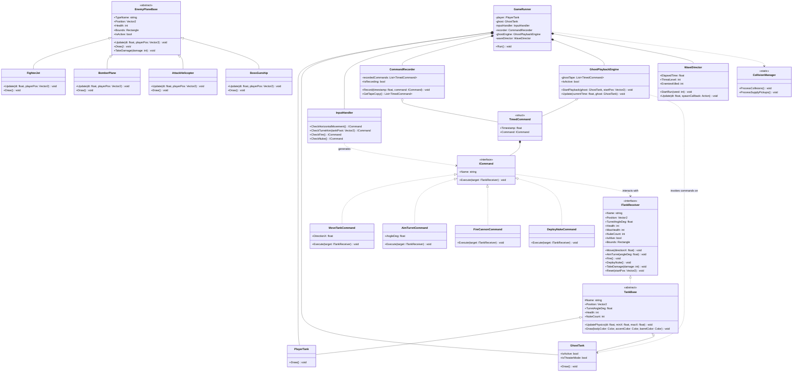

# 🎮 เอกสารเตรียมส่งผลงาน itch.io: Heavy Weapons (OOP & Command Pattern)

เอกสารนี้รวบรวมเนื้อหาและข้อมูลสำหรับนำไปกรอกบนหน้ากิจกรรม itch.io และใช้เป็นแนวทางการส่งงานให้ครบถ้วนตามเกณฑ์ประเมิน (Rubric) 100%

---

## 📋 เช็คลิสต์ตรวจสอบความพร้อมการส่งงาน (Deliverables Checklist)

| สิ่งที่ต้องส่ง (Deliverable) | สถานะ | สิ่งที่ต้องทำต่อ / ตำแหน่งไฟล์ |
| :--- | :---: | :--- |
| **1. ตัวเกม (Game Build)** | ✅ **พร้อมส่ง** | ไฟล์ `HeavyWeapons_Windows.zip` (ขนาด ~4.2 MB) สร้างเสร็จแล้วที่รูทโปรเจกต์ อัปโหลดขึ้น itch.io ได้ทันที |
| **2. ข้อมูลผู้จัดทำ (Team Members)** | ⚠️ **รอผู้เรียนกรอก** | กรอก ชื่อ-นามสกุล, รหัสนักศึกษา, Section ลงในส่วนข้อมูลผู้จัดทำ |
| **3. ภาพคลาสไดอะแกรม (Class Diagram)** | ✅ **มีให้พร้อม** | ไดอะแกรม Mermaid UML ด้านล่าง สามารถแคปภาพหรือแปลงเป็น PNG ได้ |
| **4. ภาพสกรีนช็อต (Screenshots 3-5 ภาพ)** | ⚠️ **รอแคปภาพ** | รันเกมแล้วกดถ่ายภาพตาม 4 จังหวะสำคัญที่ระบุไว้ในคู่มือนี้ |
| **5. คำอธิบายเชิงเทคนิค (Technical Description)** | ✅ **เขียนเสร็จสมบูรณ์** | คัดลอกข้อความในหัวข้อ Technical Description ด้านล่างไปวางใน itch.io ได้เลย |
| **6. ลิงก์ GitHub Repository** | ⚠️ **รอ Push โค้ด** | สั่ง Git Push โฟลเดอร์งานขึ้น Public GitHub |
| **7. ลิงก์วิดีโอเดโม (Demo Video 1-3 นาที)** | ⚠️ **รออัดคลิป** | มีบทพูดและสคริปต์เตรียมไว้ให้ตามหัวข้อ Demo Video Script ด้านล่าง |

---

## 🏛️ ภาพคลาสไดอะแกรม (Class Diagram)

---

## 📝 ข้อความสำหรับใส่หน้า itch.io (Game Page Description)

*(คัดลอกส่วนนี้ไปใส่ในหน้า Description ของเกมบน itch.io)*

### 🎖️ Heavy Weapons: Endless Air Raid Survival & Replay Theater

**Heavy Weapons** เป็นเกม Retro Arcade 2D Shooting ที่พัฒนาขึ้นด้วยภาษา C# (.NET 10.0) และ Raylib-cs โดยออกแบบสถาปัตยกรรมระบบตามหลักการ **Object-Oriented Programming (OOP)** และ **GoF Command Pattern พร้อมระบบ Replay Theater**

#### 👥 ข้อมูลผู้จัดทำ (Team Members)
* **ชื่อ-นามสกุล:** [กรอกชื่อ-นามสกุล]
* **รหัสนักศึกษา:** [กรอกรหัสนักศึกษา]
* **กลุ่มเรียน (Section):** [กรอก Section เช่น CS201 / GI161]
* **สถาบัน:** คณะเทคโนโลยีสารสนเทศและนวัตกรรม มหาวิทยาลัยกรุงเทพ

---

### 🕹️ ลูปการเล่นและระบบเมนู (Complete Game Loop & Controls)
* **1. Loading Screen:** หน้าจอจำลองการบูตระบบและตรวจสอบโมดูล OOP ของเกม พร้อม Progress Bar
* **2. Main Menu:** หน้าจอเมนูหลักพร้อมกราฟิก Searchlights ส่องฟากฟ้า รองรับทั้งเมาส์และคีย์บอร์ด
  * `[1] START MISSION`: เริ่มต้นภารกิจ Endless Survival ทันที
  * `[2] HOW TO PLAY & INTEL`: อ่านข้อมูลยุทธวิธี การควบคุม และข้อมูลอากาศยานศัตรู
  * `[3] WATCH LAST REPLAY THEATER`: ดู Replay ย้อนหลังของรอบล่าสุด (ใช้งานได้เมื่อเล่นจบไปแล้ว 1 รอบ)
  * `[4] EXIT TO DESKTOP`: ออกจากเกม
* **3. Live Combat (ระหว่างเล่น):**
  * `[A / D]` หรือ `[ลูกศรซ้าย / ขวา]`: เคลื่อนที่รถถัง
  * `[Mouse Cursor]`: เล็งป้อมปืนขึ้นท้องฟ้า
  * `[Spacebar / คลิกซ้าย]`: ยิงปืนใหญ่หลัก
  * `[คลิกขวา / B / F]`: ปล่อยระเบิดนิวเคลียร์ล้างจอ
  * `[ESC / M]`: พักเกมและกลับสู่เมนูหลัก
* **4. Game Over Screen:**
  * `[P]`: ดู REPLAY THEATER รอบล่าสุด
  * `[Space / Enter]`: เล่นใหม่อีกครั้งทันที
  * `[M / ESC]`: กลับสู่หน้าเมนูหลัก (Main Menu)
* **5. Replay Theater:**
  * `[P / Space / ESC]`: ออกจาก Replay กลับสู่หน้าจอ Game Over ได้ตลอดเวลาโดยไม่หลุดเกม

---

### 🔬 คำอธิบายเชิงเทคนิค (Technical Description)

#### 1. การประยุกต์ใช้ 4 เสาหลักของ OOP (4 Pillars of OOP)
* **Encapsulation (การห่อหุ้ม):** ซ่อนสถานะภายในและการคำนวณที่ซับซ้อน เช่น ฟิสิกส์ล้อสายพาน, องศาป้อมปืน, สถานะกระแสคำสั่งใน `CommandRecorder`, และตรรกะการบินของอากาศยานไว้ภายในคลาส
* **Abstraction (การแยกส่วนเชิงนามธรรม):** ใช้ Interface `ICommand` กำหนดสัญญาการสั่งการโดยไม่ผูกมัดกับการกดปุ่ม และ `ITankReceiver` กำหนดความสามารถของรถถัง ทำให้ตัวละครรถถังจริงและร่างเงาสามารถรับคำสั่งเดียวกันได้
* **Inheritance (การสืบทอด):** 
  * รถถัง: `TankBase` สืบทอดเป็น `PlayerTank` (รถถังผู้เล่นจริง) และ `GhostTank` (รถถังสำหรับ Replay)
  * อากาศยาน: `EnemyPlaneBase` สืบทอดคุณสมบัติร่วมไปยัง `FighterJet`, `BomberPlane`, `AttackHelicopter`, และ `BossGunship`
* **Polymorphism (ภาวะพหุสัณฐาน):**
  * `ICommand.Execute(target)` สามารถสั่งการลงบน Receiver ตัวใดก็ได้ ไม่ว่าจะเป็น `PlayerTank` หรือ `GhostTank`
  * อากาศยานแต่ละชนิด Override เมธอด `Update(dt, playerPos)` และ `Draw()` ทำให้แต่ละลำมีพฤติกรรมการบิน การกราดยิง และการทิ้งระเบิดที่แตกต่างกันอย่างสิ้นเชิงใน Game Loop เดียวกัน

#### 2. GoF Command Pattern Architecture
เกมนี้แปลงการกระทำของผู้เล่นจาก Hardware Input ให้กลายเป็น **First-Class Object** โดยแบ่งออกเป็น 4 องค์ประกอบหลัก:
1. **Command Interface (`ICommand`):** สัญญาแม่บทที่มีเมธอด `Execute(ITankReceiver target)`
2. **Concrete Commands:** `MoveTankCommand`, `AimTurretCommand`, `FireCannonCommand`, และ `DeployNukeCommand`
3. **Receivers:** `PlayerTank` และ `GhostTank` ที่ปฏิบัติตามคำสั่งจริง
4. **Invokers:**
   * `InputHandler` (Live Invoker): ตรวจจับคีย์บอร์ด/เมาส์แบบ Event-driven แล้วสร้าง Command ส่งให้ผู้เล่น
   * `GhostPlaybackEngine` (Replay Invoker): อ่านกระแสคำสั่งตามไทม์สแตมป์แล้ว Execute สั่ง Replay Tank

#### 3. โครงสร้างข้อมูลและการปรับปรุงหน่วยความจำ (Data Structures & Memory Optimization)
* **Timestamped Command Stream (`List<TimedCommand>`):** บันทึกคำสั่งเฉพาะเมื่อมีการเปลี่ยนแปลง (Event-driven) เช่น เมื่อเปลี่ยนทิศทางเดิน หรือเมื่อกดยิง ทำให้ไฟล์ Replay มีขนาดเพียงไม่กี่ KBs (Zero-Alloc Struct) แทนที่จะต้องบันทึกเป็นคลิปวิดีโอ (MBs)
* **Circular Queue (`Queue<string>`):** บันทึกข้อความ Log การทำงานของ Command Pattern แบบ FIFO เพื่อแสดงผลบน Console HUD แบบเรียลไทม์
* **Dynamic Entity Pools (`List<T>`):** จัดการกระสุน, ระเบิด, สะเก็ดไฟอนุภาค (Particles) และกล่องเสบียงชูชีพ (Supply Drops) แบบไดนามิก

---

## 📸 คำแนะนำการแคปภาพสกรีนช็อต (Screenshots 3-5 ภาพ)

1. **ภาพที่ 1 (Live Combat & Variety of Aircraft):** จังหวะที่ผู้เล่นกำลังขับรถถังและเล็งปืนใหญ่ยิงขึ้นฟ้า โดยมีเครื่องบินหลายชนิด (Fighter Jet พ่นไอพ่น, Bomber ทิ้งระเบิด, Helicopter) อยู่บนจอพร้อมกัน
2. **ภาพที่ 2 (Action Juice & Particle Effects):** จังหวะระเบิดลูกระเบิดศัตรู หรือจังหวะที่ผู้เล่นกดระเบิดนิวเคลียร์ (Nuke Shockwave) มีสะเก็ดไฟระเบิดกระจายทั่วจอ
3. **ภาพที่ 3 (Supply Airdrop):** ภาพกล่องพยาบาลหรือกล่องนิวเคลียร์กำลังกางร่มชูชีพร่อนลงมาจากฟ้า
4. **ภาพที่ 4 (Game Over Screen):** หน้าจอสรุปผล แสดงเวลาการรอดชีวิต, คะแนน, จำนวนศัตรูที่ยิงตก และปุ่มคำสั่ง [P] ดู Replay
5. **ภาพที่ 5 (Replay Theater Mode):** หน้าจอขณะกดดู Replay ที่มีแถบ Timeline Progress Bar สีส้มด้านบน และรถถัง Replay Tank แสดงคำสั่งย้อนหลัง

---

## 🎬 โครงร่างสคริปต์วิดีโอเดโม (Demo Video Script: 1 – 3 นาที)

* **0:00 - 0:30 (แนะนำตัวและคอนเซปต์):**
  * "สวัสดีครับ วันนี้กลุ่มของพวกเราจะมานำเสนอเกม Heavy Weapons: Endless Survival ซึ่งพัฒนาด้วย C# และ Raylib-cs..."
  * แสดงตัวเกมและอธิบายว่าผู้เล่นต้องควบคุมรถถังยิงสกัดกั้นฝูงบินที่เข้ามาอย่างต่อเนื่อง
* **0:30 - 1:15 (สาธิตระบบเกมเพลย์และ OOP ในเกมจริง):**
  * โชว์การเคลื่อนที่ การเล็งป้อมปืนตามเมาส์ และการยิง
  * ชี้ให้เห็นว่าศัตรูแต่ละชนิดสืบทอดจาก `EnemyPlaneBase` (Polymorphism) ทำให้มีพฤติกรรมต่างกัน: Jet กราดยิงปืนกล, Bomber ทิ้งระเบิดดาเมจ 35, และ Heli ยิงจรวดนำวิถี
  * โชว์การกดปุ่มคลิกขวาปล่อยระเบิดนิวเคลียร์ (Nuke Command) ล้างจอ
* **1:15 - 2:00 (เจาะลึก Command Pattern & Replay System):**
  * ชี้ไปที่กล่อง HUD ด้านขวาบน: "ระบบของเราใช้ GoF Command Pattern แปลงการควบคุมให้เป็น Command Object และบันทึกลง CommandRecorder แบบ Timestamped Stream..."
  * เมื่อรถถังพัง แสดงหน้าจอ Game Over แล้วกดปุ่ม **[P]** เพื่อเข้าสู่ **Replay Theater**
  * อธิบายว่าในโหมด Replay ตัวละครจริงจะถูกซ่อน และให้ `GhostPlaybackEngine` นำเทปคำสั่งมา Execute ลงบน Replay Tank เพื่อเล่นซ้ำได้อย่างแม่นยำ 100% โดยใช้พื้นที่เก็บข้อมูลเพียงไม่กี่กิโลไบต์
* **2:00 - 2:30 (สรุปและจบการนำเสนอ):**
  * สรุปความสำคัญของการแยกส่วน (Decoupling) ที่ทำให้เกมสามารถเพิ่มระบบ Replay หรือ AI ได้อย่างง่ายดาย ขอบคุณครับ/ค่ะ

