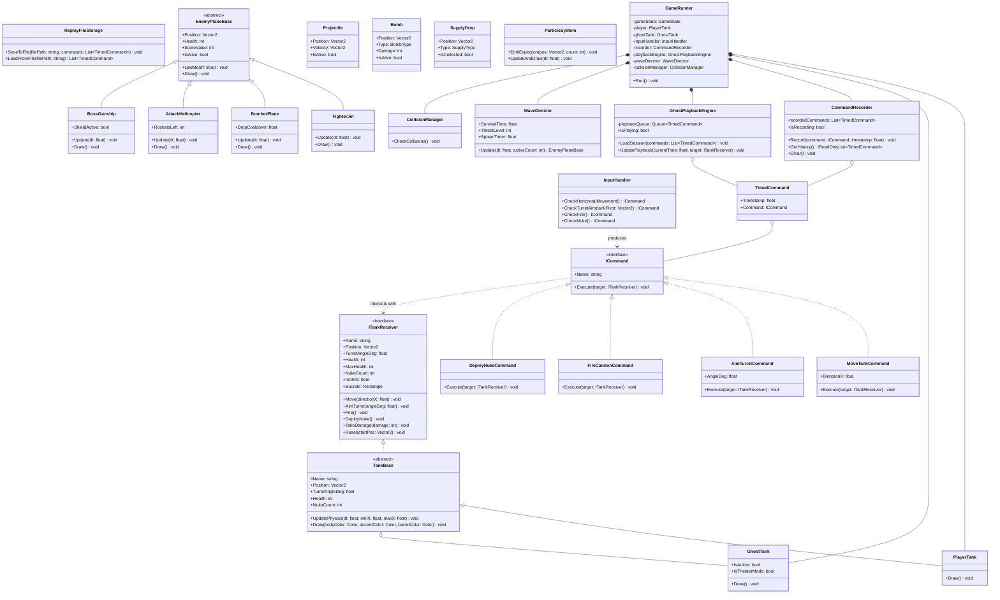

# 🚀 Skybreaker
### Endless Air Raid Survival & GoF Command Pattern Replay System
เกมแนว Retro Arcade 2D พัฒนาด้วยภาษา **C# (.NET 10.0)** และกราฟิกไลบรารี **Raylib-cs** โดยนำเสนอสถาปัตยกรรม **Object-Oriented Programming (OOP)** ขั้นสูง ร่วมกับ **GoF Command Pattern** และระบบ **Ghost Replay Theater**

---

## 🏛️ ภาพคลาสไดอะแกรม (Class Diagram)

โครงสร้างสถาปัตยกรรมเชิงวัตถุและการเชื่อมต่อของระบบทั้งหมดภายในเกม **Skybreaker**:



---

## 🕹️ ลูปการเล่นและระบบเมนู (Complete Game Loop & Controls)

เกมทำงานด้วยระบบ Finite State Machine (FSM) หมุนเวียนต่อเนื่องโดยไม่มีจุดค้างของเกม:

```
[ Loading Screen ] 
       │ (Auto 100% or Press Space)
       ▼
 [ Main Menu ] ◄─────────────────────────────────────────────┐
   │         ▲                                               │
   │ [1]     │ [ESC / M]                                     │
   ▼         │                                               │
 [ Live Survival ] ──(HP <= 0)──► [ Game Over ]              │
                                     │         ▲             │
                                 [P] │         │ (Replay End)│
                                     ▼         │             │
                             [ Replay Theater ] ─────────────┘
```

### 1. ลูปการทำงานของหน้าจอ (Game States)
* **Loading Screen:** โหลดโมดูลระบบ FSM และ Command Pattern พร้อมแถบแสดงผลความคืบหน้า (0% - 100%) ข้ามได้ทันทีด้วย `[Space]` หรือ `[Enter]`
* **Main Menu:** เมนูหน้าหลักพร้อมระบบไฟ Searchlight ค้นหาเป้าหมายบนฟ้าแบบไดนามิก รองรับการคลิกเมาส์และปุ่มลัด `[1-4]`
  * `[1] START MISSION`: เข้าสู่สมรภูมิรบ
  * `[2] HOW TO PLAY`: ดูคู่มือยุทธวิธีและระบบควบคุม
  * `[3] REPLAY THEATER`: ดูภาพบันทึกการเล่นย้อนหลังของรอบล่าสุด (เปิดใช้งานอัตโนมัติเมื่อเล่นจบ)
  * `[4] EXIT`: ปิดเกม
* **Live Survival:** ผู้เล่นควบคุมรถถังยิงสกัดฝูงบินที่บุกเข้ามาไม่หยุดตามระดับเวลาความยาก (Endless Progression)
* **Game Over:** สรุปผลการรบ (เวลาที่รอด, คะแนน, จำนวนเครื่องบินที่ทำลาย) สามารถกด `[P]` เพื่อดูภาพรีเพลย์ หรือ `[Space]` เพื่อเริ่มรอบใหม่ได้ทันที
* **Replay Theater:** ระบบโรงภาพยนตร์รีเพลย์ ปิดระบบควบคุมของผู้เล่น ซ่อนตัวละครผู้เล่นจริง และนำ `GhostTank` มาแสดงการเคลื่อนไหวและยิงตาม Timestamp คำสั่ง 100% พร้อมแถบ Timeline Progress Bar

### 2. การควบคุม (Controls)
| ปุ่มควบคุม | คำสั่งในเกม | ผลลัพธ์ทางเทคนิค (Command Object) |
| :--- | :--- | :--- |
| **`[A]` / `[D]`** หรือ **`[←]` / `[→]`** | เคลื่อนที่รถถังซ้าย-ขวา | สร้าง `MoveTankCommand` ส่งเข้า Receiver |
| **`[Mouse Movement]`** | เล็งองศาป้อมปืนตามเคอร์เซอร์ | สร้าง `AimTurretCommand` คำนวณมุม Radian/Degree |
| **`[Spacebar]`** หรือ **`[คลิกซ้าย]`** | ยิงกระสุนปืนใหญ่หลัก | สร้าง `FireCannonCommand` สร้างอนุภาคกระสุน |
| **`[คลิกขวา]`** หรือ **`[B]` / `[F]`** | ปล่อยระเบิดนิวเคลียร์ล้างจอ | สร้าง `DeployNukeCommand` เคลียร์ยูนิตศัตรูทั้งหมด |
| **`[P]`** (หน้า Game Over) | รับชม Replay Theater | สลับเข้าสู่ Replay Mode พร้อมโหลดคิวคำสั่งย้อนหลัง |
| **`[M]` / `[ESC]`** | เมนูหลัก / ยกเลิก | กลับสู่หน้า Main Menu (ไม่ปิดเกมกะทันหัน) |

---

## 🔬 คำอธิบายเชิงเทคนิค (Technical Description)

### 1. สถาปัตยกรรม GoF Command Pattern & Replay System
* **Decoupling of Invoker & Receiver:** แยกส่วนการตรวจจับอินพุต (`InputHandler`) ออกจากการกระทำของรถถัง (`ITankReceiver`) โดยอินพุตจะสร้าง **Command Objects** (`MoveTankCommand`, `AimTurretCommand`, `FireCannonCommand`, `DeployNukeCommand`) 
* **Dual Execution & Stream Recording:** ในขณะที่ผู้เล่นควบคุมเกม Command จะถูกเรียก `.Execute(playerTank)` และส่งต่อไปยัง `CommandRecorder` เพื่อประทับเวลา (`Timestamp`) เก็บเป็นรายการ `TimedCommand` ต่อเนื่อง
* **Deterministic Replay Theater:** เมื่อเข้าสู่โหมดรีเพลย์ ระบบจะนำประวัติคำสั่งทั้งหมดส่งเข้า `GhostPlaybackEngine` และแปลงเป็น **FIFO Queue (`Queue<TimedCommand>`)** เพื่อทยอยปลดปล่อยและ Execute ให้กับ `GhostTank` ตามไทม์สแตมป์จริง ช่วยให้ได้การเล่นซ้ำที่แม่นยำ 100% โดยบันทึกขนาดไฟล์เพียงระดับ Kilobytes (ไม่จำเป็นต้องบันทึกวิดีโอไฟล์ใหญ่)

### 2. หลักการ Object-Oriented Programming (OOP)
* **Encapsulation:** ทุก Entity (เช่น `TankBase`, `EnemyPlaneBase`, `Bomb`, `SupplyDrop`) ห่อหุ้มคุณลักษณะสถานะพิกัด (`Vector2 Position`), พลังชีวิต (`Health`), และความเร็ว (`Velocity`) ไว้ภายใน โดยมีเมธอดควบคุมความปลอดภัยไม่ให้ถูกแก้ไขโดยตรงจากภายนอก
* **Inheritance & Polymorphism:** 
  * คลาส `TankBase` เป็นฐานให้ `PlayerTank` (ตัวละครผู้เล่นจริง) และ `GhostTank` (ตัวแทนเล่นซ้ำใน Replay) สามารถปรับแต่งสีสัน เลเยอร์การวาด และสถานะความเป็นอมตะได้อย่างอิสระผ่าน Interface เดียวกัน (`ITankReceiver`)
  * คลาส `EnemyPlaneBase` เป็นฐานให้ศัตรู 4 ประเภท:
    1. `FighterJet` (บินโฉบเร็ว กราดยิงกระสุนคู่)
    2. `BomberPlane` (เครื่องบินทิ้งระเบิดหนัก ดาเมจ 35 HP)
    3. `AttackHelicopter` (บินลอยลำ เล็งยิงจรวดมิสไซล์นำวิถี)
    4. `BossGunship` (ป้อมปราการอากาศยาน เกราะหนาพร้อมระบบยิงปืนกลรอบทิศทาง)
* **Interface Segregation:** ใช้ `ICommand` กำหนดรูปแบบการทำงานของคำสั่ง และ `ITankReceiver` กำหนดความสามารถของรถถัง ทำให้รองรับการขยายระบบ เช่น เพิ่ม AI Bot หรือ Multiplayer ในอนาคตได้อย่างง่ายดาย

### 3. โครงสร้างข้อมูลที่เลือกใช้ (Data Structures)
* **`List<T>` (Dynamic Collection):** จัดการกลุ่มของ Entities ในฉาก เช่น กระสุน (`List<Projectile>`), ลูกระเบิด (`List<Bomb>`), ละอองสะเก็ดไฟอนุภาค (`List<Particle>`), และกล่องเสบียง (`List<SupplyDrop>`) เพื่อความยืดหยุ่นในการเพิ่ม/ลบแบบ Dynamic
* **`Queue<TimedCommand>` (FIFO Data Structure):** ใช้ใน `GhostPlaybackEngine` เพื่อเรียงลำดับคำสั่งรีเพลย์ตามช่วงเวลาจากอดีตไปสู่อนาคต คำสั่งที่ถูก Execute แล้วจะถูก Dequeue ออกทันทีอย่างมีประสิทธิภาพสูง
* **`Fixed-size Circular Buffer / Queue`:** นำมาใช้แสดงผล Log รายการ Command ที่กำลังถูกประมวลผลบนหน้าจอ HUD ด้านขวาบนแบบ Real-time
