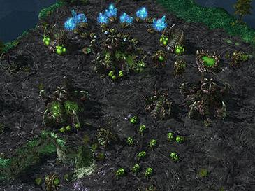
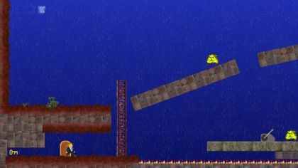
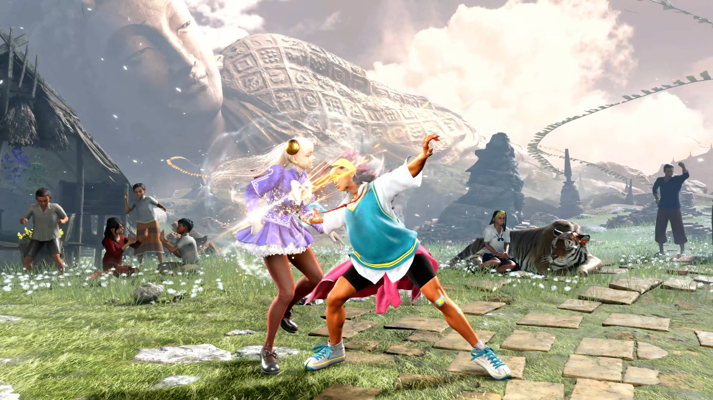
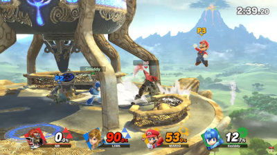
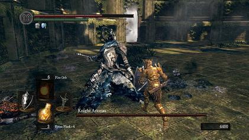

# 🎮 Week 8: Command Pattern & Ghost Replay Engine
## สถาปัตยกรรมการแปลงอินพุตเป็นอ็อบเจกต์คำสั่งและการจำลองภาพซ้ำเสมือน
### 2D Speedrun Platformer: Decoupled Inputs & Personal Best Ghost Replay

**ผู้สอน:** คณาจารย์ประจำหลักสูตรเกมและสื่ออินเทอร์แอคทีฟ (GI)  
**คณะเทคโนโลยีสารสนเทศและนวัตกรรม | มหาวิทยาลัยกรุงเทพ**

---

# 📑 Roadmap การเรียนรู้สัปดาห์ที่ 8

1. **Part 0: The Hook & Direct Input Anti-Pattern**
   - กับดักการผูกฮาร์ดแวร์ไว้ใน `Update()` ของตัวละคร และเหตุผลที่เกมไม่สามารถทำ Replay ได้
2. **Part 1: Gang of Four (GoF) Command Pattern Fundamentals**
   - แก่นแท้ 4 องค์ประกอบ: Client, Invoker, Command, และ Receiver
3. **Part 2: 6 Real-World Industry Case Studies**
   - เจาะลึกเกมระดับโลก: *Trackmania, StarCraft II, Braid, Street Fighter 6, Super Smash Bros., และ Dark Souls*
4. **Part 3: Ghost Replay Architecture & Memory Optimization**
   - เปรียบเทียบ Frame Snapshotting (MBs) vs Timestamped Command Stream (KBs)
5. **Part 4: C# & Raylib-cs Implementation Walkthrough**
   - วิเคราะห์โค้ดสถาปัตยกรรมตัวอย่าง Platformer Speedrun พร้อมร่างเงา Personal Best
6. **Part 5: Clean Code & Architecture Evaluation**

---

# 💥 Part 0: ปัญหาของการผูกติดฮาร์ดแวร์ (The Direct Input Anti-Pattern)

ในเกมระดับเริ่มต้น นักศึกษามักเขียนโค้ดอ่านคีย์บอร์ดลงใน `Update()` ของคลาสตัวละครโดยตรง:

```csharp
// ❌ Direct Hardware Polling Anti-Pattern
public class Player
{
    public void Update(float dt)
    {
        if (Raylib.IsKeyDown(KeyboardKey.D))
            Position.X += speed * dt;
        if (Raylib.IsKeyPressed(KeyboardKey.Space) && isGrounded)
            Velocity.Y = -jumpForce;
    }
}
```

- **ข้อจำกัดรุนแรง 4 ประการ:**
  1. <span class="red">No Rebinding:</span> ไม่สามารถเปลี่ยนปุ่มควบคุมหรือสลับไปใช้ Gamepad / Mobile Touch ได้อย่างยืดหยุ่น
  2. <span class="red">No Ghost / AI Injection:</span> บอทหรือร่างเงาไม่สามารถสั่งการตัวละครได้ เพราะติดเช็คคีย์บอร์ดจริง
  3. <span class="red">No Replay System:</span> ไม่สามารถบันทึกและย้อนดูการเล่นซ้ำได้เลย
  4. <span class="red">Untestable:</span> ไม่สามารถเขียน Automated Unit Test จำลองการเล่นได้

---

# ❌ The Anti-Pattern: Direct Hardware Polling Coupling

<div class="diagram-container">
  
</div>

---

# 💡 ทางออก: แก่นแท้ของ Command Pattern (GoF)

> *"Encapsulate a request as an object, thereby letting you parameterize clients with different requests, queue or log requests, and support undoable operations."*  
> — **Gang of Four (Design Patterns: Elements of Reusable Object-Oriented Software)**

<br/>

- แทนที่การกดปุ่มจะสั่งเปลี่ยนค่า `Position` หรือ `Velocity` ทันที...
- **เราเปลี่ยน "เจตนาในการกระทำ" (Action Intent) ให้กลายเป็น First-Class Object**
- คำสั่งกลายเป็นก้อนข้อมูล (`ICommand`) ที่สามารถ:
  - <span class="green">ส่งต่อ (Pass around)</span> เป็นพารามิเตอร์ของเมธอด
  - <span class="yellow">เข้าคิว (Queue)</span> หรือจัดลำดับก่อนหลัง
  - <span class="cyan">ประทับเวลา (Timestamp)</span> เพื่อบันทึกลงใน Replay Stream
  - <span class="blue">ส่งข้ามเครือข่าย (Serialize over Network)</span> ไปยังเครื่องอื่น

---

# 🏛️ 4 องค์ประกอบหลักของ Command Pattern

| องค์ประกอบ (Role) | หน้าที่และความรับผิดชอบ | ตัวอย่างในเกม Platformer ของเรา |
| :--- | :--- | :--- |
| **1. Command Interface** | สัญญาอินเทอร์เฟซกำหนดเมธอด `Execute(Receiver)` | `ICommand` |
| **2. Concrete Commands** | คลาสคำสั่งรูปธรรม บรรจุพารามิเตอร์ของการกระทำ | `MoveCommand`, `JumpCommand` |
| **3. Receiver** | ผู้ลงมือปฏิบัติงานจริงตามกฎฟิสิกส์ของโลกเกม | `IPlatformerCharacter`<br/>(`MarioPlayer`, `GhostRunner`) |
| **4. Invoker** | ผู้ถือคำสั่ง เรียกใช้ `Execute()` หรือส่งเข้าคิว | `InputHandler` (Live)<br/>`GhostPlaybackEngine` (Replay) |

<br/>

> [!NOTE]
> ผู้เล่นสด (`MarioPlayer`) และร่างเงา (`GhostRunner`) ต่างเป็น **Receiver** ที่ใช้อินเทอร์เฟซเดียวกัน ทำให้คำสั่งชุดเดียวกันสามารถนำไปรันซ้ำกับตัวละครใดก็ได้แบบ Polymorphic!

---

# 📐 GoF Command Pattern Architecture Diagram

<div class="diagram-container">
  
</div>

---

# 🏆 Part 2: 6 กรณีศึกษาจริงในอุตสาหกรรมเกมระดับโลก

การนำ Command Pattern ไปใช้งานไม่ได้จำกัดแค่ระบบปุ่มกด แต่เป็นหัวใจของ:
1. **Ghost Racing & Speedrun Leaderboards** (*Trackmania, Mario Kart*)
2. **Deterministic Lockstep Netcode** (*StarCraft II, Age of Empires*)
3. **Timeline Rewind Mechanics** (*Braid, Prince of Persia*)
4. **Input Buffering & Frame Advantage** (*Street Fighter 6, Tekken 8*)
5. **Ultra-Compact Replay Files** (*Super Smash Bros. Ultimate*)
6. **Action Commitment & Tactical Input Queuing** (*Dark Souls, Elden Ring*)

---

# 🏁 Case Study 1: Trackmania / Mario Kart Time Attack
## Ghost Car Replay & Asynchronous Racing

<div class="case-screenshot-container">
  
  <div class="case-credit">TrackMania: แข่งขันจับเวลาควบคู่ไปกับรถร่างเงาโปร่งแสง (Ghost Car) จากสถิติที่ดีที่สุดของผู้เล่น</div>
</div>

- **กลไกสถาปัตยกรรม:**
  - ตัวเกมไม่ได้บันทึกวิดีโอ MP4 แต่บันทึก **Input Stream พร้อม Timestamp**
  - เมื่อเริ่มแข่งใหม่ รถร่างเงาโปร่งแสงจะอ่านเทปคำสั่งนี้และรันบนระบบฟิสิกส์เดียวกันเป๊ะ
  - ผู้เล่นสามารถมองเห็นไลน์การเลี้ยว การเบรก และจุดที่ได้เปรียบ/เสียเปรียบแบบเรียลไทม์

---

# ⚔️ Case Study 2: StarCraft II & Age of Empires
## Deterministic Lockstep Multiplayer Netcode

<div class="case-screenshot-container">
  
  <div class="case-credit">StarCraft II: ยูนิตนับพันตัวเคลื่อนที่และต่อสู้พร้อมกันผ่าน Lockstep Command Netcode</div>
</div>

- **ทำไมไม่ส่งพิกัดของยูนิต 1,000 ตัวผ่านเน็ต?**
  - แบนด์วิดท์จะทะลุหลายสิบเมกะไบต์ต่อวินาที และเกิดอาการกระตุกรุนแรง
  - **โซลูชัน:** ส่งเฉพาะ `Command Object` เช่น *[Player 1: Command(MoveUnits, ID 1-50, Target(X,Y))] (ขนาดเพียง 64 bytes)*
  - ทุกเครื่องประมวลผลคำสั่งตาม Simulation Tick เดียวกัน ผลลัพธ์จึงตรงกัน 100%

---

# ⏳ Case Study 3: Braid
## Reversible Command Stream & Timeline Rewind

<div class="case-screenshot-container">
  
  <div class="case-credit">Braid: ผู้เล่นสามารถกดปุ่มย้อนเวลาเพื่อแก้ไขความผิดพลาดและไขปริศนาเชิงเวลา</div>
</div>

- **การประยุกต์ใช้ GoF Command ในการย้อนเวลา:**
  - ในเกม Puzzle-Platformer ของ Jonathan Blow เมื่อผู้เล่นกระโดดพลาดตกเหว สามารถกดปุ่ม Shift ค้างไว้เพื่อกรอเวลากลับ
  - คำสั่งในอดีตจะถูกย้อนเล่นแบบ Reverse หรือคำนวณ `Undo()` ตามลำดับย้อนกลับ
  - ทำให้สามารถสร้างเมคานิกส์ปริศนาที่มีความซับซ้อนของมิติเวลาได้อย่างสมบูรณ์

---

# 🥋 Case Study 4: Street Fighter 6
## Input Buffer & Frame Advantage Mechanics

<div class="case-screenshot-container">
  
  <div class="case-credit">Street Fighter 6: แถบ Frame Meter และคอลัมน์ Input Display ทางซ้ายแสดง Command Buffer</div>
</div>

- **Input Buffering Window (4 - 7 Frames):**
  - มนุษย์ไม่สามารถกดปุ่มติดกันเป๊ะในเสี้ยววินาที 1/60 วินาที (16.6ms)
  - ตัวเกมใช้ `Command Queue` กักเก็บคำสั่งไว้ 4-7 เฟรมล่วงหน้า
  - เมื่ออนิเมชัน Recovery สิ้นสุด ตัวละครจะดึง Command ล่าสุดใน Buffer ออกมาต่อคอมโบอัตโนมัติ

---

# 💥 Case Study 5: Super Smash Bros. Ultimate
## ทำไมไฟล์ Replay .bin ถึงมีขนาดไม่ถึง 100 KB?

<div class="case-screenshot-container">
  
  <div class="case-credit">Super Smash Bros. Ultimate: การแข่งขันความยาว 8 นาที เซฟเป็นไฟล์ขนาดเพียง 60-120 KB</div>
</div>

- **ความลับของ Replay Files:**
  - วิดีโอ 8 นาที 1080p 60fps มีขนาด ~500 MB
  - แต่ไฟล์ Replay ของ Smash Bros มีขนาดเพียง **~80 KB** เพราะเก็บแค่ Sequence ของ Input Commands!
  - **ทำไมอัปเดตแพตช์แล้ว Replay เก่าพัง?** หากบาลานซ์ตัวละครเปลี่ยน เช่น *Frame Startup ลดลง 2 เฟรม* Simulation จะเกิด **Desync** ทันที!

---

# 🛡️ Case Study 6: Dark Souls & Elden Ring
## Action Commitment & Input Queue Lockout

<div class="case-screenshot-container">
  
  <div class="case-credit">Dark Souls: ระบบต่อสู้ที่อาศัยจังหวะและการล็อกคิวคำสั่ง (Commitment & Buffer Window)</div>
</div>

- **Combat Design ด้วย Command Queue:**
  - เมื่อกดฟันดาบ (R1) ตัวละครจะเข้าสู่สถานะ **Uncancelable Recovery**
  - หากผู้เล่นตื่นตระหนกกดกลิ้งหลบ (Circle) ซ้ำๆ คำสั่งกลิ้งจะถูกบันทึกเข้า Buffer
  - ทันทีที่ฟันเสร็จ ตัวละครจะกลิ้งหลบโดยอัตโนมัติ แม้ผู้เล่นจะปล่อยมือแล้วก็ตาม!
  - นี่คือเหตุผลที่เกม Souls-like รู้สึกหนักแน่นและต้องวางแผนทุกการกดปุ่ม

---

# 💾 Part 3: Ghost Replay Architecture & Memory Footprint

มีสองแนวคิดหลักในการสร้างระบบ Replay ในเกม 2D:

| คุณสมบัติ | Approach A: Frame Snapshotting (ดิบ) | Approach B: Timestamped Command Stream (สถาปัตยกรรมของเรา) |
| :--- | :--- | :--- |
| **สิ่งที่บันทึก** | ตำแหน่ง $(X,Y)$, ความเร็ว, เฟรมภาพ ทุก 60 FPS | เฉพาะ Event คำสั่งเมื่อมีอินพุตเปลี่ยน |
| **ขนาดข้อมูล / นาที** | **15 - 50 MB** (เปลืองแรมและ I/O) | **2 - 5 KB** (ประหยัดกว่า **99.9%**) |
| **ความยืดหยุ่น** | เล่นย้อนดูได้อย่างเดียว | สามารถนำคำสั่งไปประมวลผลต่อ, Train บอท AI ได้ |
| **เงื่อนไขสำคัญ** | ไม่ต้องพึ่งพาฟิสิกส์ตอน Replay | **ต้องการ Deterministic Simulation** (ฟิสิกส์ต้องแม่นยำ) |

---

# 📊 Frame Snapshot vs Timestamped Command Stream

<div class="diagram-container">
  
</div>

---

# 🔄 The Complete Ghost Replay Pipeline

<div class="diagram-container">
  
</div>

---

# 💻 Part 4: C# Implementation - The Receiver Interface

```csharp
namespace Game_CommandPattern_Completed.Core.Characters;

/// <summary>
/// สัญญาสำหรับตัวละคร Platformer (Receiver ใน Command Pattern)
/// </summary>
public interface IPlatformerCharacter
{
    string Name { get; }
    Vector2 Position { get; set; }
    Vector2 Velocity { get; set; }
    bool IsGrounded { get; set; }
    int FacingDirection { get; set; }
    bool IsRunning { get; }
    bool IsJumping { get; }

    void Move(float directionX);
    void Jump();
    void Stop();
    void Reset(Vector2 startPos);
}
```

- <span class="green">Polymorphism:</span> คำสั่ง `ICommand` มองเห็นเฉพาะสัญญา `IPlatformerCharacter` โดยไม่สนใจว่าปลายทางจะเป็นผู้เล่นสด (`MarioPlayer`) หรือร่างเงา (`GhostRunner`)

---

# 📦 C# Implementation - Concrete Commands

```csharp
public class MoveCommand : ICommand
{
    public float DirectionX { get; }
    public MoveCommand(float directionX) => DirectionX = directionX;

    public void Execute(IPlatformerCharacter target)
    {
        if (DirectionX != 0f) target.Move(DirectionX);
        else target.Stop();
    }
    public override string ToString() => $"Move({DirectionX:F1})";
}

public class JumpCommand : ICommand
{
    public void Execute(IPlatformerCharacter target)
    {
        target.Jump();
    }
    public override string ToString() => "Jump()";
}
```

---

# 🎮 C# Implementation - The Live Invoker (InputHandler)

```csharp
public class InputHandler
{
    private float _lastDirectionX = 0f;

    public ICommand? CheckHorizontalMovement()
    {
        float dir = 0f;
        if (Raylib.IsKeyDown(KeyboardKey.D) || Raylib.IsKeyDown(KeyboardKey.Right)) dir += 1f;
        if (Raylib.IsKeyDown(KeyboardKey.A) || Raylib.IsKeyDown(KeyboardKey.Left)) dir -= 1f;

        // บันทึกเฉพาะเมื่อมีการเปลี่ยนทิศทาง (Event-Driven Input Stream)
        if (dir != _lastDirectionX)
        {
            _lastDirectionX = dir;
            return new MoveCommand(dir);
        }
        return null;
    }

    public ICommand? CheckJump()
    {
        if (Raylib.IsKeyPressed(KeyboardKey.Space) || Raylib.IsKeyPressed(KeyboardKey.W))
            return new JumpCommand();
        return null;
    }
}
```

---

# 📼 C# Implementation - Command Stream Recording

```csharp
public readonly record struct TimedCommand(float Timestamp, ICommand Command);

public class CommandRecorder
{
    private readonly List<TimedCommand> _tape = new(256);
    public bool IsRecording { get; private set; }

    public void StartRecording() { _tape.Clear(); IsRecording = true; }
    
    public void Record(float timestamp, ICommand command)
    {
        if (IsRecording)
            _tape.Add(new TimedCommand(timestamp, command));
    }

    public void StopRecording() => IsRecording = false;
    public List<TimedCommand> GetTapeCopy() => new(_tape);
}
```

- <span class="cyan">Event-Driven Recording:</span> บันทึกเฉพาะเวลาที่เกิด Action ทำให้ตลอดการวิ่ง 15 วินาที มีคำสั่งเกิดขึ้นเพียง ~30-50 ตัวเท่านั้น!

---

# 👻 C# Implementation - Ghost Playback Engine

```csharp
public class GhostPlaybackEngine
{
    private readonly List<TimedCommand> _ghostTape = new(256);
    private int _playbackIndex = 0;

    public void Update(float currentLevelTime, GhostRunner ghost)
    {
        if (!IsActive || !ghost.IsActive) return;

        // ประมวลผลคำสั่งทั้งหมดที่ถึงเวลา Execute ณ เสี้ยววินาทีนี้
        while (_playbackIndex < _ghostTape.Count && 
               currentLevelTime >= _ghostTape[_playbackIndex].Timestamp)
        {
            _ghostTape[_playbackIndex].Command.Execute(ghost);
            _playbackIndex++;
        }
    }
}
```

- ตัวจักร Ghost ไม่ต้องมี AI ซับซ้อน เพียงแค่หยิบคำสั่งในเทปที่ประทับเวลาตรงกับ `_levelTimer` มา Execute ลงบน `GhostRunner`!

---

# 🎨 การสร้างบรรยากาศ Speedrun Platformer ใน Raylib

1. **Parallax Multi-Layer Background:**
   - ท้องฟ้า (Sky: $0.05\times$), ภูเขา (Mountains: $0.2\times$), ทิวไม้ (Trees: $0.45\times$)
2. **Camera2D Follow with Bounds Clamping:**
   - กล้องติดตามแกน X ของผู้เล่น ซูม $2.0\times$ ให้ภาพพิกเซลอาร์ตคมชัด
3. **Ghost Runner Cyan Shader Tint:**
   - ตัวละครร่างเงาใช้สไปรต์ชีตเดียวกับผู้เล่น แต่ย้อมสีฟ้าโปร่งแสง:
   ```csharp
   Raylib.DrawTexturePro(texture, srcRec, destRec, Vector2.Zero, 0f, 
       new Color(130, 215, 255, 140));
   ```
4. **Live HUD Command Feed:**
   - แสดงคิวคำสั่งล่าสุด 6 บรรทัดบนมุมขวาบนของหน้าจอแบบเรียลไทม์

---

# 🏗️ สรุปหลักการออกแบบตาม Clean Architecture & SOLID

- **Open/Closed Principle (OCP):**
  - ต้องการเพิ่มสกิลใหม่ (เช่น `DashCommand`, `SlideCommand`)?
  - เพียงแค่สร้างคลาสใหม่ที่ `implements ICommand` โดยไม่ต้องแก้ไขโค้ดของ `InputHandler` หรือ `GhostPlaybackEngine` แม้แต่บรรทัดเดียว!
- **Single Responsibility Principle (SRP):**
  - `InputHandler` รับผิดชอบเฉพาะการอ่านและแปลงสัญญาณฮาร์ดแวร์
  - `CommandRecorder` รับผิดชอบเฉพาะการจัดเก็บกระแสคำสั่ง
  - `GhostPlaybackEngine` รับผิดชอบเฉพาะการเล่นย้อนเทป
  - `MarioPlayer` / `GhostRunner` รับผิดชอบเฉพาะกฎฟิสิกส์และการวาดภาพ

---

# 🏁 Checklist สำหรับสถาปนิกเกม (When to use Command Pattern?)

### ✅ ควรใช้เมื่อ:
- ต้องการระบบ **Input Rebinding / Multi-Platform Controller Mapping**
- ต้องการระบบ **Replay / Ghost Playback** ที่มีขนาดไฟล์เล็กระดับ KBs
- เกมมีระบบ **Multiplayer Lockstep Netcode** แบบ RTS หรือ MOBA
- เกมแนวต่อสู้หรือ Souls-like ที่ต้องมี **Input Buffering & Action Queue**

### ⚠️ ไม่จำเป็นต้องใช้เมื่อ:
- เกม Casual ขนาดเล็กที่ปุ่มกดไม่มีความซับซ้อนและไม่มีระบบ Replay
- การสร้างคลาสคำสั่งมากเกินไปอาจเพิ่ม Boilerplate Code หากโปรเจกต์ไม่ได้ต้องการความยืดหยุ่น

---

# ❓ Q&A & Lab Session

<br/>

### "Any sufficiently advanced technology is indistinguishable from deterministic replay."

<br/>

**ต่อไปในสัปดาห์ที่ 9:**  
*Component Pattern & Entity-Component Architecture: การทลายข้อจำกัดของ Monolithic Class สู่ระบบเกมที่ประกอบร่างได้อย่างอิสระ*

**Bangkok University | Games & Interactive Media**

